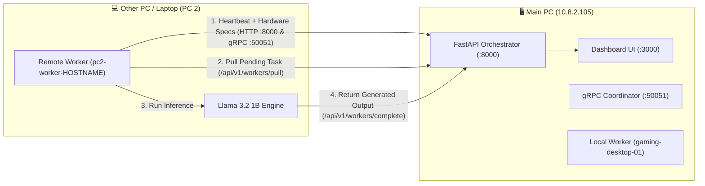

# 🌐 How to Connect Another PC to QThorium Compute Mesh

This guide explains step-by-step how to connect **Main PC (PC 1)** and **any other PC/Laptop (PC 2, PC 3, etc.)** over the same Wi-Fi / LAN network so they combine their CPU/RAM hardware resources and execute AI tasks together using **Llama 3.2 1B**.

---

## 🏗️ Network Architecture



---

## 🖥️ Part 1: Prepare the Main PC (Host — `10.8.2.105`)

> **Requirement**: Both PCs must be connected to the **same Wi-Fi or LAN network**.

### 1. Check the Main PC's IP Address
Run this in PowerShell on the **Main PC**:
```powershell
(Get-NetIPAddress -AddressFamily IPv4 | Where-Object { $_.IPAddress -notlike "127.*" -and $_.IPAddress -notlike "169.254.*" -and $_.InterfaceAlias -match "Wi-Fi|Ethernet" } | Select-Object -First 1).IPAddress
```
*(Current Main PC IP: **`10.8.2.105`**)*

### 2. Allow Incoming Connections in Windows Firewall (Run Once as Admin)
```powershell
New-NetFirewallRule -DisplayName "QThorium Mesh Inbound" -Direction Inbound -LocalPort 8000,50051,3000 -Protocol TCP -Action Allow
```

### 3. Start the Main PC Services
Open PowerShell in the project folder (`qthorium_mesh`) and run:

```powershell
# Activate virtual environment (if using .venv)
if (Test-Path ".venv\Scripts\Activate.ps1") { & .\.venv\Scripts\Activate.ps1 }
$env:PYTHONPATH = "."

# 1. Start gRPC Coordinator (:50051)
Start-Process powershell -ArgumentList "-NoExit", "-Command", "`$env:PYTHONPATH='.'; python track3_networking/run_grpc_server.py --port 50051"

# 2. Start Central Orchestrator & API (:8000)
Start-Process powershell -ArgumentList "-NoExit", "-Command", "`$env:PYTHONPATH='.'; python -m uvicorn track2_orchestrator.main:app --host 0.0.0.0 --port 8000"

# 3. Start Local Worker Node
Start-Process powershell -ArgumentList "-NoExit", "-Command", "`$env:PYTHONPATH='.'; python track1_worker_node/main.py"

# 4. Start Dashboard UI (:3000)
Start-Process powershell -ArgumentList "-NoExit", "-Command", "npm --prefix track4_dashboard_ui/track4_dashboard_ui/frontend_app run dev -- --host 0.0.0.0"
```

- **Main PC Dashboard URL**: `http://localhost:3000` (or `http://10.8.2.105:3000` from any device on the network)
- **Main PC API Health Check**: `http://10.8.2.105:8000/health`

---

## 💻 Part 2: Connect the Other PC (PC 2) to the Main PC

Perform these steps in **PowerShell** on the **2nd PC (PC 2)**:

### Step 1: Clone or Pull the Latest Code
```powershell
$WorkDir = "$HOME\Desktop\qthorium_mesh"
if (!(Test-Path "$WorkDir\.git")) {
    git clone https://github.com/surajchandr1c/mesh.git $WorkDir
}
Set-Location $WorkDir
git fetch origin main
git reset --hard origin/main
```

### Step 2: Set Up Python Environment & Model
```powershell
if (!(Test-Path ".venv")) { python -m venv .venv }
& .\.venv\Scripts\Activate.ps1
pip install -r requirements.txt

# Download Llama 3.2 1B GGUF model if not already in ./models/
if (!(Test-Path "models\Llama-3.2-1B-Instruct-Q4_K_M.gguf")) {
    New-Item -ItemType Directory -Force -Path "models" | Out-Null
    Invoke-WebRequest -Uri "https://huggingface.co/bartowski/Llama-3.2-1B-Instruct-GGUF/resolve/main/Llama-3.2-1B-Instruct-Q4_K_M.gguf" -OutFile "models\Llama-3.2-1B-Instruct-Q4_K_M.gguf"
}
```

### Step 3: Configure `.env` on PC 2 with Main PC's IP (`10.8.2.105`)
Replace `10.8.2.105` only if your Main PC's IP changed:
```powershell
$MainPC_IP = "10.8.2.105"
$pc2NodeId = "pc2-worker-$env:COMPUTERNAME"

@"
REDIS_URL=redis://${MainPC_IP}:6379/0
ORCHESTRATOR_URL=http://${MainPC_IP}:8000
NODE_ID=$pc2NodeId
NODE_API_KEY=mesh-node-secret-key-v1
GRPC_TARGET=${MainPC_IP}:50051

TARGET_MODEL=llama3.2:1b
OLLAMA_HOST=http://localhost:11434
WORKER_CPU_THRESHOLD=98.0
WORKER_RAM_THRESHOLD=99.0

JWT_SECRET_KEY=volunpc-secret-key-change-in-production-12345
REQUIRE_AUTH=false
CHROMA_DB_PATH=./chroma_db
API_HOST=0.0.0.0
API_PORT=8000
"@ | Set-Content -Path ".env" -Encoding UTF8
```

### Step 4: Verify Network Connection from PC 2 to Main PC
```powershell
Test-NetConnection -ComputerName 10.8.2.105 -Port 8000
Test-NetConnection -ComputerName 10.8.2.105 -Port 50051
Invoke-RestMethod -Uri "http://10.8.2.105:8000/health"
```
Both `TcpTestSucceeded` checks should return **`True`**, and `/health` should return `{"status":"healthy",...}`.

### Step 5: Start the Worker Node on PC 2
```powershell
$env:PYTHONPATH = "."
python track1_worker_node/main.py
```
As soon as this starts:
- PC 2 sends heartbeats and its real hardware specs (CPU cores, RAM, Disk) to `http://10.8.2.105:8000/api/v1/workers/heartbeat` every 3 seconds.
- On the **Main PC Dashboard (`http://localhost:3000`)**:
  - **Workers Page**: Shows `pc2-worker-<HOSTNAME>` as **`HEALTHY` (`Online`)**.
  - **System Health & Telemetry Page**: Automatically combines both PCs' CPU cores, RAM, and storage into the **Combined Connected PCs Resource Pool**.

---

## 🚀 Part 3: Send a Task from PC 2 & Generate Output on PC 2

While `python track1_worker_node/main.py` is running on PC 2, open a second PowerShell window on **PC 2** (or use the **Task Registry -> Dispatch Task** button in the browser UI) and run:

```powershell
$body = @{
    prompt       = "[From PC 2 ($env:COMPUTERNAME)] Explain in 2 bullet points how distributed compute meshes work."
    max_tokens   = 128
    rag_enabled  = $false
    target_model = "llama3.2:1b"
} | ConvertTo-Json

$res = Invoke-RestMethod -Uri "http://10.8.2.105:8000/api/v1/tasks/submit" -Method Post -ContentType "application/json" -Body $body
Write-Host "Submitted Task ID: $($res.task_id)" -ForegroundColor Green
```

### What Happens Automatically:
1. **Main PC** receives the task and displays **`📥 Task Received from PC 2`** in the **Task Execution Registry**.
2. **PC 2's Worker Node** pulls the task, runs **Llama 3.2 1B** locally on **PC 2**, and sends the generated response back to Main PC.
3. **Main PC Dashboard** updates the task to **`COMPLETED`** with the green **`⚡ Generated on PC 2`** badge and displays the generated output.

---

## 🤖 Want Antigravity on PC 2 to Do Everything Automatically?

Instead of running the commands manually on PC 2, open **[PC2_FULL_PROMPT.md](file:///c:/Users/Suraj/Desktop/Practice/Hackathone/qthorium_mesh/PC2_FULL_PROMPT.md)**, copy the prompt block inside, and paste it into **Antigravity on PC 2**. Antigravity will automatically configure `.env`, connect to `10.8.2.105`, start the worker, and send + verify 2 tasks end-to-end.
